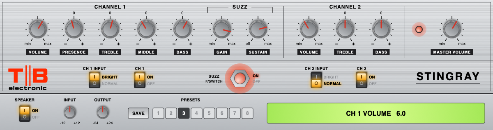

# TB Carlsbro Stingray (Mountain Lion VST)

A model of the **Carlsbro Stingray** guitar amplifier head (the original 1974 family, solid
state) as a VST 2.4 plugin, 64-bit Intel, for **Mac OS X 10.8.5** (Pro Tools 11 through Blue Cat
PatchWork). Non-commercial, personal use.

## First revision: built without a schematic

No Stingray schematic has been found yet. This revision is built from a photo of the front
panel and the way a 1970s Carlsbro transistor/op-amp head of this kind works, so **every
circuit value below is an estimate**. All of them are named constants in the "Estimates"
block of `Source/DSP/StingrayAmp.cpp`. When the schematic turns up, the circuit is rebuilt
from it in that one file; the panel, parameters and presets stay as they are.

The one part taken from a real drawing is the **Suzz**: the amp's built-in Suzz has the same
name and the same two controls (Gain, Sustain) as Carlsbro's Suzz pedal, so it uses the pedal's
circuit from TB Suzz (Gottfried Divos's drawing).

## The panel

Laid out like the Stingray head's silver front panel, left to right:

| Upper band | Channel 1: **Volume, Presence, Treble, Middle, Bass** — Suzz: **Gain, Sustain** — Channel 2: **Volume, Treble, Bass** — pilot lamp, **Master Volume** |
|---|---|
| Switch band | **Ch 1 Input** Normal/Bright rocker, **Ch 1** on rocker, **Suzz** footswitch (glows red when on), **Ch 2 Input** Normal/Bright rocker, **Ch 2** on rocker |
| Plugin strip | **Speaker** (miked 2x12 or speaker terminals), **Input** ±12 dB, **Output** ±24 dB, 8 nameable presets, readout |

Scales are marked as on the amp: min/max, off/max for Sustain, and − 0 + for the tone controls
(the readout shows them as -5..+5). The amp's two input jacks per channel are replaced by one
input per channel with a Normal/Bright rocker, and each channel has an on switch so the guitar
can feed Ch 1, Ch 2 or both. The f/switch jack becomes a footswitch for the Suzz.

## What is modelled (4x oversampled)

- **Input stages** (circuits): the jack through 100K into a 741 at x22, 100K bias; the
  Bright jack puts 1n across the 100K (up to +6 dB above about 1.6 kHz).
- **Suzz** (Ch 1, circuit): the input stage padded back to guitar level (22K / 2K2), then the
  Suzz pedal: CA741 with 470K over 470R + 1u + SUSTAIN (22K reverse log), its lopsided 9 V
  swing, 4u7 / 100K / 3K3 / 220n and GAIN (470R) at the output, then make-up gain (x16).
  The footswitch crossfades between clean and Suzz.
- **Volume** (log), then the **active tone controls**, cut/boost with 0 at the top:
  Bass (low shelf, 100 Hz, ±15 dB), Middle (700 Hz, ±12 dB), Treble (high shelf, 3 kHz,
  ±15 dB), Presence (5 kHz, ±10 dB, Ch 1 only); Ch 2 has Bass and Treble.
- **Recovery stages**: x6, clipping like a 741 on ±15 V rails (cranked Volume overdrives here).
- **Mixer**: inverting 741 summing both channels, then **Master Volume** (log).
- **Power amp** (100 W into 8 ohms): gain, slew, clipping on ±48 V rails that sag on
  4700u reservoirs, V-I current limiting into the electrical model of the owner's **2x12 with
  two Carlsbro Powertone 60 12" speakers (8 ohms)**, plus the cab's acoustic voice.

### Estimates (until the schematic turns up)

| Constant | Value |
|---|---|
| Input stage | 100K series, 100K bias, x22; Bright cap 1n |
| Suzz pad / make-up | 22K / 2K2, x16 |
| Tone controls | Bass 100 Hz ±15 dB, Middle 700 Hz Q 0.7 ±12 dB, Treble 3 kHz ±15 dB, Presence 5 kHz Q 0.9 ±10 dB |
| Recovery stage | x6, 741 on ±15 V |
| Power amp | gain 22, ±48 V rails, 2.5 ohm supply, 8 A limit, 2 V/us |
| Powertone 60 pair | Re 6.4 ohm, Fs 85 Hz, Qms 4, Qes 0.6, Le 0.6 mH |
| Cab voice | peaks at 200 Hz, 1.2 kHz, 2.5 kHz (+6 dB), 4 kHz; rolls off above 5.5 kHz |

## Build and test

GitHub Actions builds and verifies the bundle on an Intel macOS runner (minimum OS 10.8.5,
only 10.8-era system libraries), loads it in a mini host, drives the panel offscreen and
publishes screenshots to the `gui-preview` branch. Locally on Linux:

    make -C Tests run vst-run      # DSP tests, preset store, plugin in a mini VST host
    make -C Tests asan             # the same under AddressSanitizer + UBSan

## Install

1. Actions → latest run → Artifacts → **TB-Carlsbro-Stingray-mountain-lion-vst** → download.
2. Unzip (twice: the artifact zip holds `TB-Carlsbro-Stingray-mountain-lion-vst.zip`).
3. Copy **TB Carlsbro Stingray.vst** to `/Library/Audio/Plug-Ins/VST/`.
4. Rescan in Blue Cat PatchWork.

Presets live in `~/Library/Application Support/TB/TB Carlsbro Stingray/Presets.txt`.
